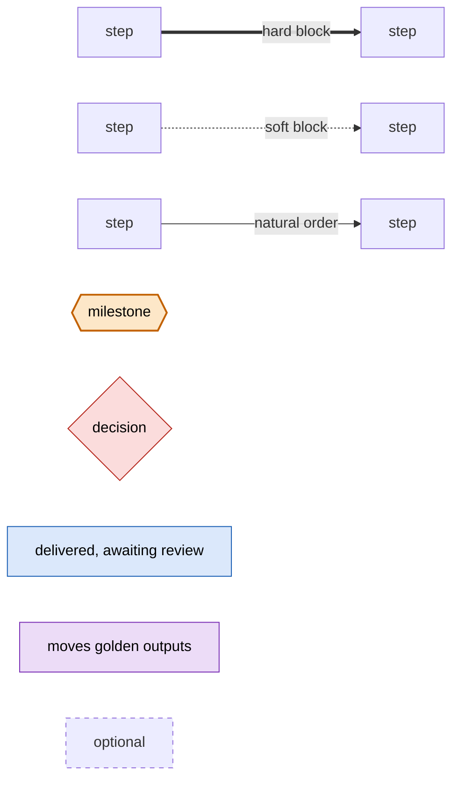
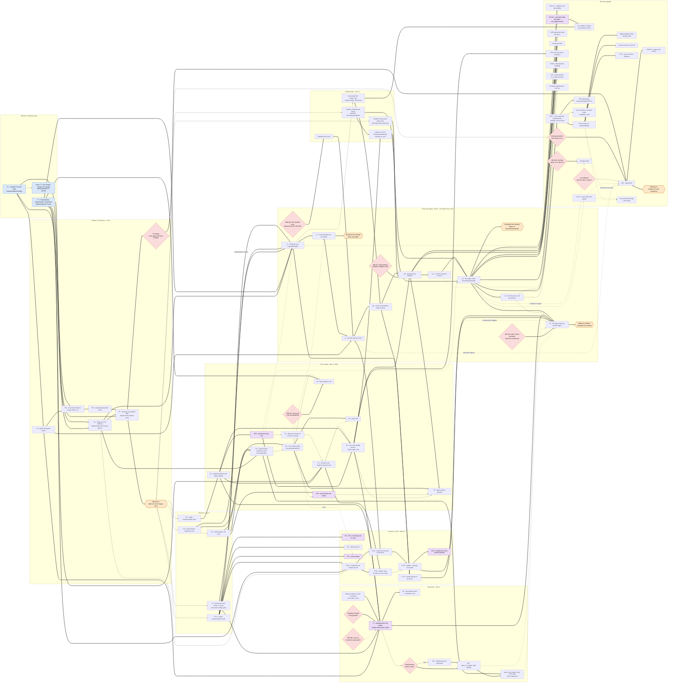

# Implementation graph: every remaining step, across the plans

**Created**: Oct 19 2026
**Purpose**: one picture to pilot the order of work. It holds every step still to do in:
- [REC_EVENT_CAPABILITY_REFACTORING_PLAN.md](REC_EVENT_CAPABILITY_REFACTORING_PLAN.md) (CAP,
  tandem D);
- [ERROR_MODEL_REWRITE_PLAN.md](ERROR_MODEL_REWRITE_PLAN.md) (ERR);
- [ENGINE_MIGRATION_PLAN.md](ENGINE_MIGRATION_PLAN.md) (MIG);
- [GENERATION_REWRITE_PLAN.md](GENERATION_REWRITE_PLAN.md) (GEN): only its §6 is left;
- [ITERATE_GENERIC_REWRITE_PLAN.md](ITERATE_GENERIC_REWRITE_PLAN.md) (ITER): R4, the optional
  S4d, the tier work and its §9;
- the steps of [ARCHITECTURE_SYNTHESIS.md](ARCHITECTURE_SYNTHESIS.md) (SYN) that come after the
  migration;
- what the hand-over of [doc/LAYER_REFACTORING_PROPOSAL.md](../doc/LAYER_REFACTORING_PROPOSAL.md)
  (LAYER) leaves;
- the landing of AA Pgen.

The plans hold the content of each step; this document holds only the order.
**Status**: as of Oct 19 2026, `origin/feature/tandemD` @ `814442b`.

---

## 1. Reading the graph

- **Hard block** (thick): the step cannot be done, or cannot stay bitwise, before the other lands.
- **Soft block** (dotted): it can, at the cost of redoing work or of a golden move inside a
  bitwise block.
- **Natural order** (plain): no dependency, only the order the decisions or the file sets make
  sensible. For example, everything after milestone 1 waits for it because tandem D comes first,
  not because of the code.
- **Milestones** (hexagons) are the states the plans name: milestone 1 and 2, and the migration's
  checkpoints into `develop`.
- **Decisions** (diamonds) are the open questions that gate a step.

The subgraphs are the migration's lanes (MIG §4): steps in one lane share files and run in
sequence; steps in different lanes run in parallel.

---

## 2. The graph

---

## 3. The paths that matter

**To milestone 1.** The longest chain is T1's review → T2 → T5a → T5b → T5. T3's review and T7a
join it at T5. Nothing in the error-model plan or the migration is on it.

**To the migration's end.** The chain is lane D: L0 → L1 → L2 → L3 → L4a → L4b → L4c → L5 → L8.
Each other lane must arrive in time:
- **lane E**: E0 → E1 → ER1 → E4, before L4b;
- **lane M**: the handler M-step (MCUT) and the `AccumulatorSet` (MACC) before L4; the registry
  and the importer (MREG, MIMP) before L5;
- **lane G**: L7, before L8;
- **lane C**: CT3b and CT4, before L8;
- **hypermutation**: H0 → H1 → T7b, before L5, softly; H5 before L8, or the adapter is kept (Q7).

ER1, the one golden move on the way, lands before L1 so that every lane-D step stays bitwise.

**To real tandem data (milestone 2).** It runs through T5's timings:
- **If the legacy DFS is fast enough:** B10 can follow L3, where adjacency per scenario has a home.
- **If it is too slow, the expected outcome:** B10 waits for `ChainDPEngine`, after L5 and the
  synthesis' step 7.

B10's representation (CAP B10, options (b) and (c)) is decided at the same time.

**Steps that can start right after milestone 1, in parallel.**
- Lane T, the tests: L0, CT0, E0, H0.
- Lane M: MCUT, MREG.
- In lane C, the CX3 repair as soon as CT0 confirms the defect: it can corrupt memory on long reads.

---

## 4. The nodes

Status: **review** — delivered on its branch, awaiting merge · **pending** — ready once its hard
blocks land · **gated** — waits on a decision or on a step of another plan · **optional**.

### Delivered, awaiting review
| Node | Source | Hard blocks | Status |
|---|---|---|---|
| T1 | CAP *T1* | — | review; conflicts with T3 in `Rec_Event.cpp` (both add functions at one spot: keep both) |
| T3 | CAP *T3* | — | review |
| Plans | CAP, ERR, MIG, this document | — | review; the branch contains T1 |

### Tandem D, milestone 1
| Node | Source | Hard blocks | Soft | Status |
|---|---|---|---|---|
| T2 | CAP blocker T2 | T1 | — | pending |
| T7a | CAP *T7*, ERR §4.1 | T1, T3 | — | pending |
| T5a | CAP *T5* | T1, T2 | — | pending; the fixture script, the v2 model, the marginals filled into IGoR's own layout |
| T5b | CAP *T5* | T5a | — | pending |
| T5 | CAP *T5* | T5b, T7a, T3 | — | pending |
| Milestone 1 | CAP | T5 | — | — |
| T5 timings | MIG Q14 | T5 | — | decision |

### Lane T, tests first
| Node | Source | Hard blocks | Soft | Status |
|---|---|---|---|---|
| L0 | MIG §3 | — | milestone 1 (priority) | pending |
| CT0 | MIG §2.6 | — | milestone 1 | pending |
| E0 | ERR §4.2 | — | milestone 1 | pending |
| H0 | ERR §4.3 | — | milestone 1 | pending |
| H1 | ERR §4.3 | — | H0 | pending |

### Lane E, error models
| Node | Source | Hard blocks | Soft | Status |
|---|---|---|---|---|
| E1 | ERR §4.2 | E0 | — | pending |
| ER1 | ERR §4.2, X13 | E1 | — | pending; moves every inference golden once |
| E2 | ERR §4.2 | — | after ER1 | pending |
| E3 | ERR §4.2 | T3, E1 | after E2 | pending |
| E4 | ERR §4.2, X20 | E1, ER1 | after E3 | pending |
| T7b | CAP *T7*, ERR §4.3 | H0, H1, T7a | — | gated on H0, H1 |
| H2 | ERR §4.3 | H1 | after T7b | pending |
| H3 | ERR §4.3, CAP B3 | T3, ERR Q7 | after H2 | gated on Q7 |
| H4 | ERR §4.3 | H2 | E3 | pending |
| HR | ERR §4.3 | H1 | after H2 | pending; moves the hypermutation goldens |
| H5 | ERR §4.3 | H2, L4b | after HR, E4 | gated on L4b |

### Lane C, counters
| Node | Source | Hard blocks | Soft | Status |
|---|---|---|---|---|
| CR, CX3 | MIG §2.3 | CT0 | — | pending; repair early |
| CT1 | MIG §2.6 | CT0 | — | pending |
| CR | MIG §2.6 | CT0 | E2 (CX13) | pending; each repair names the outputs it moves |
| CT2a | MIG §2.6, T7b's counter half | CT0, T3 | after T7a | pending |
| CT3a | MIG §2.5 | CT2a, E3 | — | pending |
| CT2b | MIG §2.6 | CT2a, L3 | — | gated on L3 |
| CT3b | MIG §2.5 | CT2b | after CT3a | gated on L3 |
| CR-P | MIG §2.5 | CT3b | — | moves the coverage goldens once |
| CT4 | MIG §2.6 | L1, L4a | — | gated on L4a |

### Lane D, driver and engine
| Node | Source | Hard blocks | Soft | Status |
|---|---|---|---|---|
| L1 | MIG §3 | L0, CT0, T3, T7a; H0 for hypermutation models | ER1 | pending |
| L2 | MIG §3 | L1 | E2 | pending |
| L3 | MIG §3 | L2, T2, labelled axes | — | gated on Q3–Q5 |
| L4a | MIG §3 | L3, AccumulatorSet | — | pending |
| L4b | MIG §3 | L4a, handler M-step, E4, Q7 | — | gated on Q7 |
| L4c | MIG §3 | L4b | — | pending |
| L5 | MIG §3 | L4c, registry ownership, importer | T7b | pending |
| L6 | MIG §3 | L5 | — | pending; benchmarked |
| L8 | MIG §3 | L5, L7, CT3b, CT4, Q15/Q16 | L6, H5 (or the adapter), T6b, the enums | gated |
| Checkpoints | MIG §4 | L2, L5, L8 | — | — |

### Lane M, Model module
| Node | Source | Hard blocks | Soft | Status |
|---|---|---|---|---|
| Labelled tensor axes | MIG Q3, REV §15.4 | Q3–Q5 | — | gated |
| AccumulatorSet | SYN step 8, MERGE §6.2 | — | after L1, which defines the interface | pending |
| Handler M-step at the legacy rule | MIG §1.1, §3 | — | milestone 1 | pending |
| Registry, ordering, layout | MERGE §4.2, SYN §5 | — | milestone 1 | pending |
| Importer, `topology_to_json` | SYN step 4, LAYER §6 | registry ownership, E4 | — | pending |

### Lane G, generation
| Node | Source | Hard blocks | Soft | Status |
|---|---|---|---|---|
| Markov sampler | GEN §6 | — | — | pending |
| L7 | MIG §3, GEN §6, SYN step 1 | L0, E1, E4, T2, the Markov sampler, the precision choice | ERR Q5 | pending; moves the `generate` goldens once |
| R4 | ITER §6.9 | L7 | — | gated on L7 |
| T4b | CAP *T4* | FastGenerator kept | — | gated on the decision |
| T6b | CAP *T6* | T4b, or FastGenerator retired | — | gated |
| `Gene_class_legacy`, `Utils.h` | CAP, LAYER hand-over | T7b, T6b | — | gated |

### After the migration
| Node | Source | Hard blocks | Soft | Status |
|---|---|---|---|---|
| Phase C | CAP, MIG §7 | L5 | L1 | gated |
| SYN 4b | SYN step 4b | — | after L5, to keep its golden move outside | moves the marginal-file goldens once |
| fmt, validate, overlays | REV §14–15 | SYN 4b, AccumulatorSet | — | gated |
| SYN 5 | SYN step 5 | — | L5 | gated |
| SYN 7 | SYN step 7, ITER §2.10 | L5 | after L6 | gated |
| DFS-B | SYN step 7, REV §10.3 | SYN 7 | — | gated |
| Rest of Phase A | CAP | — | after SYN 7 | gated |
| SYN 9, Phase D | SYN step 9, CAP | SYN 7 | — | gated |
| DpBoundedDfs, FFBS | REV §5.3 | SYN 9 | — | gated |
| k-best on the DP | REV §5.1 | SYN 9 | — | gated |
| CT5 | MIG §2.6 | SYN 9 | — | gated |
| D1/D2 tying, B9 step 3 | CAP, SYN §4 | L4b | — | gated |
| Covariates | SYN, REV §6 | L4b, L5 | — | gated |
| Per-parent error rate | ERR §3.4 | L5, E4 | — | gated |
| `Events_map` by capability | ITER §9 | L5 | — | gated |
| S4d | ITER §6 | — | L4c | optional |
| Container performance | CAP D4 | — | after L6 | optional |
| B10 | CAP B10 | T5's timings, its representation | L3 if the DFS suffices; SYN 9 otherwise; SYN 5; the `int_undefined` decision | gated |
| GEN D6 | GEN §4 | B10 | — | gated |
| Milestone 2 | CAP | B10 | — | — |
| AA Pgen | CAP H1–H9, MIG Q13 | Q13 | after L5, or before L2 opens | gated |
| Non-canonical biology | VDJ review | — | SYN 5, SYN 9 | optional, research |

---

## 5. Keeping it current

- When a step lands, delete its node and its edges, and its row; record the landing in its plan.
- When a plan adds a step, add a node with its hard blocks first, then any soft blocks and its
  natural order, and give it a row.
- A soft block that is overruled — a step done before it, accepting the rework — is recorded in
  the step's plan, and the edge goes.
- A decision node goes once the decision is recorded in its plan; the steps it gated become
  pending.
